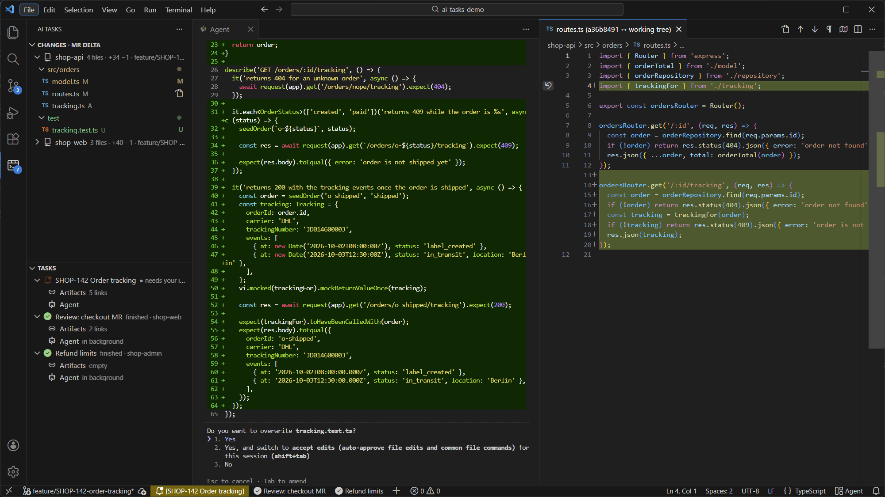
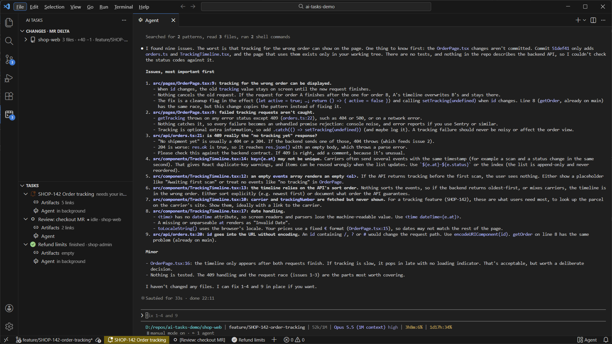
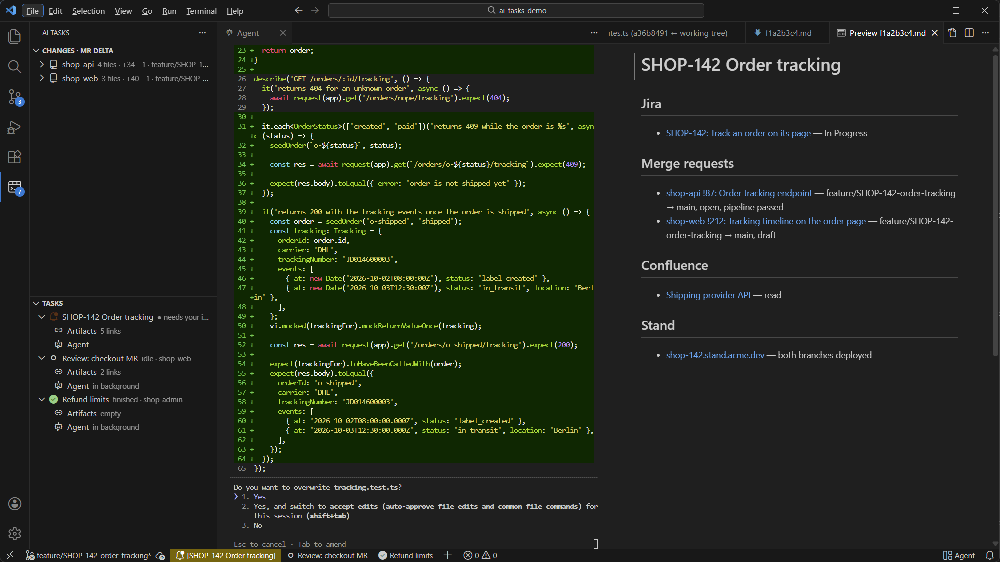
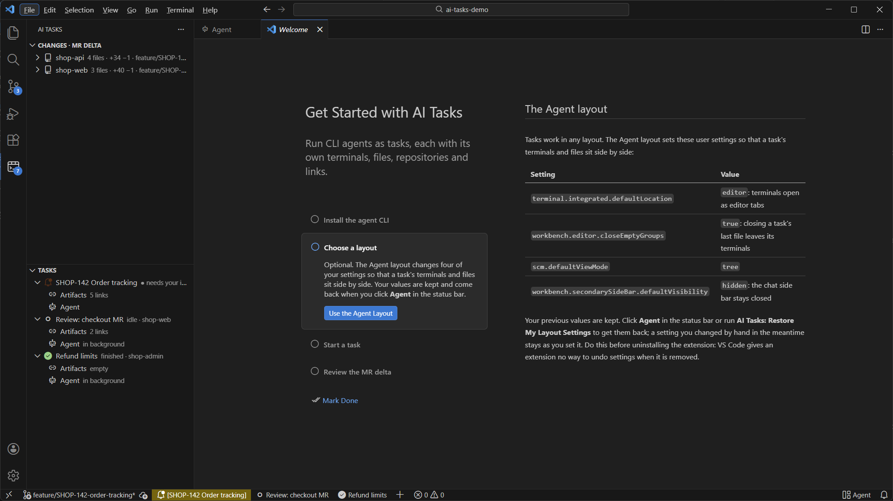

# AI Tasks

**Run several CLI agents in VS Code at once, one task each.** A task is an agent such as
[Claude Code](https://claude.com/claude-code) with its own terminals, its own open files, its own
repositories and the links it produced. Switch tasks like browser tabs: the others keep working in
the background and tell you when they need you.

[](https://github.com/eldlatypov/ai-tasks/raw/HEAD/media/screenshots/tasks-and-mr-delta.png)

## Every task knows its state

The Tasks view and the status bar show what each agent is doing: working, **needs your input**
(a permission prompt or a question), finished, idle. A task that needs you in the background lights
up and raises a notification, so you can leave agents running and come back when it matters.

Switching tasks hides the other task's terminals and files and brings back this one's, exactly as
you left them. The processes keep running; showing a terminal again replays its screen.

[](https://github.com/eldlatypov/ai-tasks/raw/HEAD/media/screenshots/task-switch.png)

## The merge request delta, across repositories

**Changes** lists what the active task's branches change against their base branch, from the merge
base to the working tree, untracked files included: what reviewers will see. It covers every
repository the task's agent touched, so a feature that spans `shop-api` and `shop-web` shows up as
one list. Click a file for the diff; switch to plain uncommitted changes from the view's title bar.

## Links in one place

Under each task, **Artifacts** keeps the links the work produced: the Jira issue, merge requests in
every repository, Confluence pages, the feature stand. The agent adds them as it goes.

[](https://github.com/eldlatypov/ai-tasks/raw/HEAD/media/screenshots/artifacts.png)

## Your VS Code stays yours

AI Tasks works in your normal profile and changes no settings by itself. The optional **Agent
layout** (terminals as editor tabs, empty editor groups close, the chat side bar stays hidden) is
offered once and lives in **Get Started with AI Tasks**; one click in the status bar puts your own
settings back. Restore them before uninstalling: VS Code gives an extension no way to undo settings
when it is removed.

[](https://github.com/eldlatypov/ai-tasks/raw/HEAD/media/screenshots/get-started.png)

## Getting started

1. Install the agent CLI and check that `claude` runs in a terminal (or set `aiTasks.agentCommand`).
2. **Ctrl+Alt+N** starts a task: pick its folder, name it, and the agent opens.
3. **Ctrl+Alt+1…9** switches tasks, **Ctrl+Alt+T** picks one from a list,
   **Ctrl+Alt+`** opens another terminal in the current task.

Agents start with `claude --settings <file>` that adds hooks reporting their state; your own Claude
Code settings are not changed, and the hooks do nothing outside task terminals. After a window
reload the tasks are kept and the active one resumes its session.

**Settings:** `aiTasks.agentCommand` (default `claude`), `aiTasks.baseBranch` (the MR delta's base
when it is not the remote's default branch, e.g. `origin/develop`), `aiTasks.shell` and
`aiTasks.shellArgs` (default: PowerShell on Windows, `$SHELL` elsewhere),
`aiTasks.resumeActiveTaskOnStartup`.

## Development

```
npm install
npm run package          # typecheck, bundle, ai-tasks.vsix
code --install-extension ai-tasks.vsix --force
```

Publishing to [Open VSX](https://open-vsx.org): bump `version`, add a CHANGELOG entry, push `main`
to GitHub (the store page loads the screenshots from there), then `npm run publish:ovsx`. The
access token comes from `OVSX_PAT`, in the environment or in a git-ignored `.env` next to
`package.json` (`OVSX_PAT=...`).

- `src/tasks.ts`: tasks, switching, per-task editors, persistence.
- `src/backgroundTerminal.ts`: terminals whose process outlives the tab. The process runs in
  VS Code's own node-pty and a headless xterm keeps the screen, so hiding a terminal only closes
  its view; showing it replays the screen. On Windows a lone `^V` from VS Code's PowerShell paste
  binding is turned into a paste of the clipboard.
- `src/status.ts` + `hooks/hook.js`: the hooks write the agent state to a per-task file, ask the
  agent to keep the artifacts file and log the paths it writes to.
- `src/changes.ts`, `src/branchDelta.ts`, `src/repoTracker.ts`: the Changes view over the active
  task's repositories, uncommitted or as the MR delta.
- `src/taskStrip.ts`: tasks and the layout switch in the status bar.
- `src/layoutMode.ts`: the optional Agent layout: offers it once, applies a few settings and
  restores the previous values.
